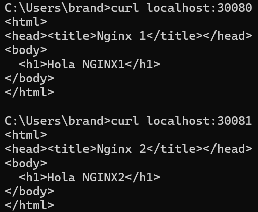
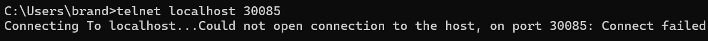
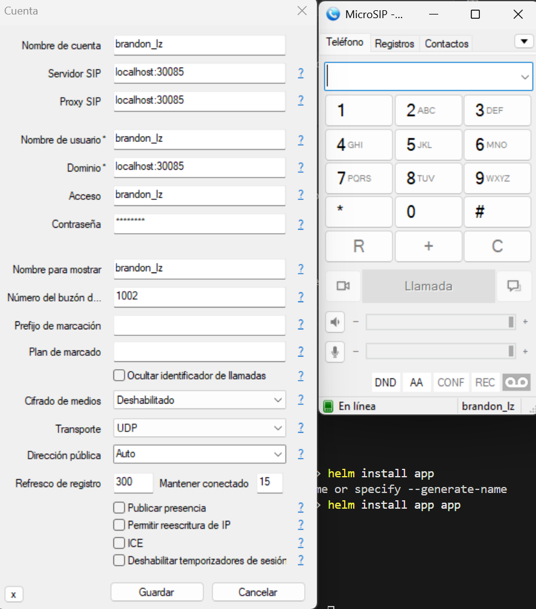
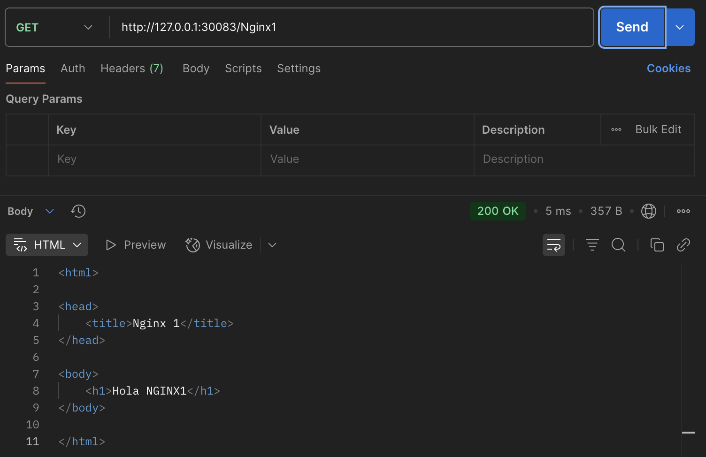
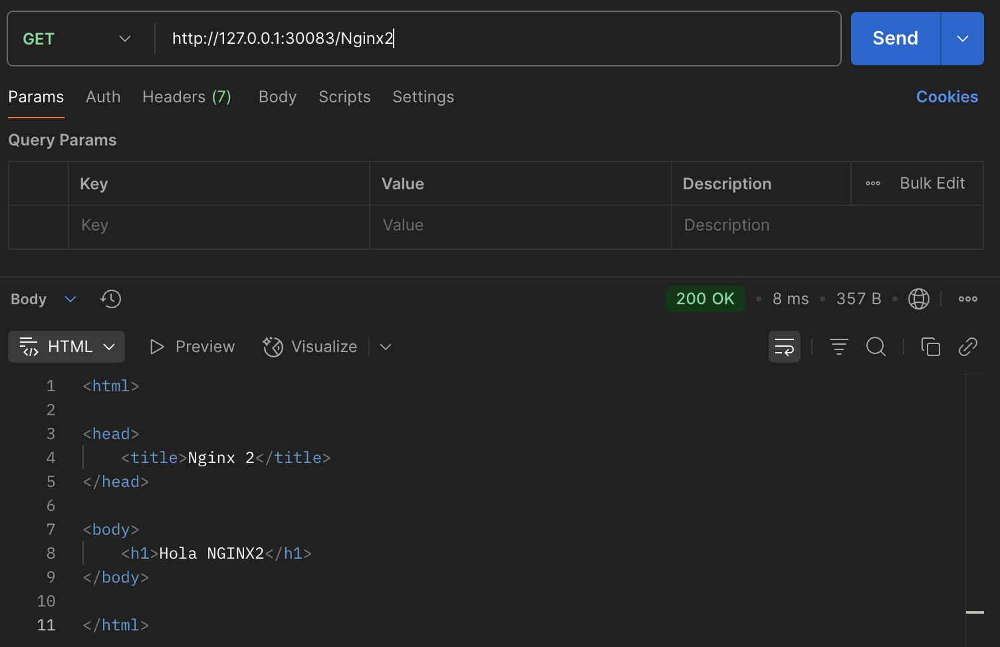
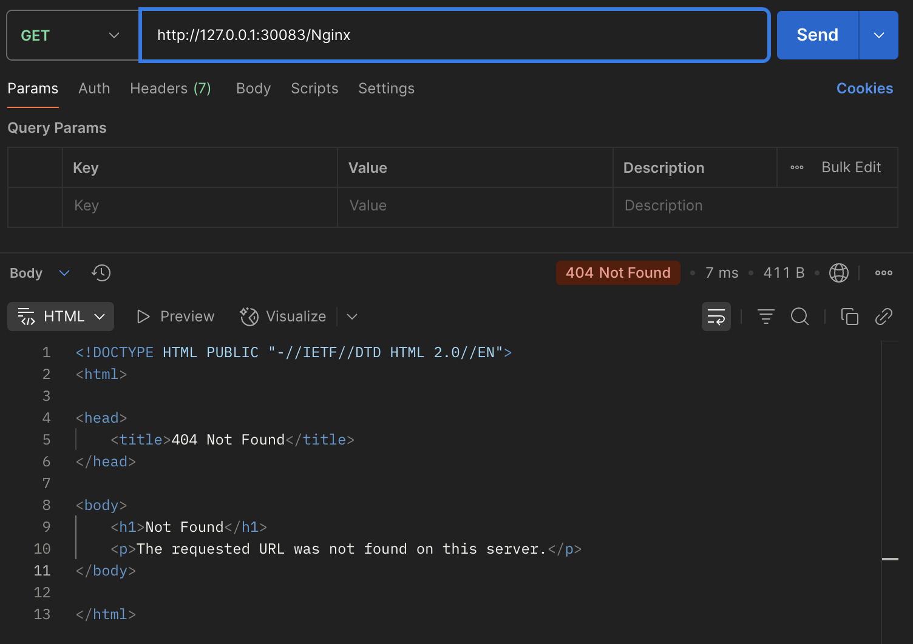
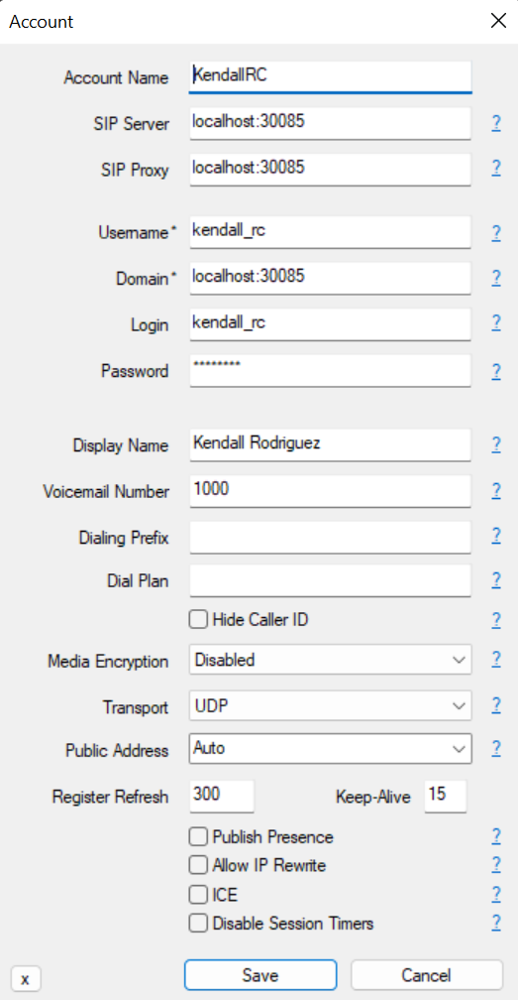
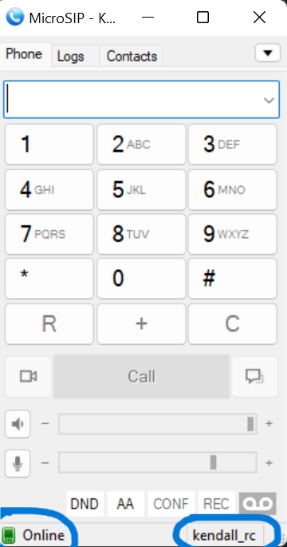
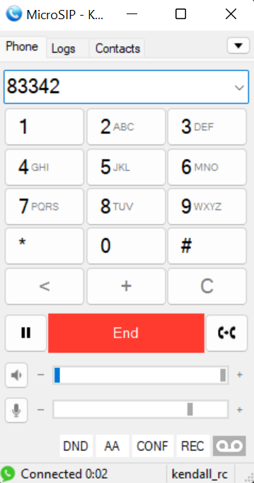

# Diseño de la Arquitectura

La solución se construyó sobre Kubernetes para orquestrar y administrar todos los servicios describen en este proyecto.

Con el fin de organizar mejor la infraestructura y separar responsabilidades, se definieron dos Namespaces dentro del clúster:  
- publico
- privado


## Recursos en el Namespace Público
Dentro de este namespace se ubican los componentes que deben ofrecer acceso externo, ya que actúan como intermediarios entre los clientes y los servicios internos.

### Router

El Router se implementa a partir de una imagen base de CentOS y se configura utilizando nftables.  
Su función principal es redirigir el tráfico entrante hacia los distintos servicios internos. En este caso, el tráfico TCP y UDP en los puertos definidos se dirige a FreeSWITCH, mientras que las peticiones al puerto TCP/8080 son redirigidas a NGINX 1, las del puerto TCP/8081 hacia NGINX 2, y finalmente, el puerto TCP/80 se encamina al Ingress Controller.


### Ingress Controller
Un Ingress Controller es un componente de Kubernetes que funciona como un proxy inverso y un punto de entrada para el tráfico HTTP externo al clúster. Su responsabilidad principal es inspeccionar las peticiones entrantes y, basándose en reglas predefinidas, redirigirlas a los servicios internos correctos. En este proyecto, el Ingress Controller se implementa utilizando Apache HTTP Server, para esto se realizaron los siguientes pasos:
- Se creó un Deployment utilizando la imagen de Apache HTTP Server.
- Se definió un ConfigMap que contiene el archivo de configuración principal de Apache (httpd.conf), acá se establecen los puertos, el ServerName, y las reglas de enrutamiento para el tráfico entrante.
  - En este archivo se configuraron los módulos necesarios y la salida de logs para integrarse con el sistema de logging de Kubernetes.
  - También se definió un bloque <VirtualHost *:80> como punto de entrada de todas las peticiones, donde se ajustaron parámetros de seguridad y se añadieron reglas de proxy para redirigir el tráfico hacia los servicios internos `nginx1-service` y `nginx2-service`.

En esta configuración, cuando un cliente accede a `http://127.0.0.1:80/Nginx1`, la solicitud se dirige hacia NGINX 1, mientras que si accede a `http://127.0.0.1:80/Nginx2`, la petición es redirigida hacia NGINX 2.


## Recursos en el Namespace Privado
En este namespace se alojan los servicios internos que no deben ser accesibles directamente desde el exterior, garantizando así aislamiento y seguridad dentro del clúster.


### NGINX 1
NGINX 1 es un servidor web simple que, al ser accedido, muestra el mensaje `"Hola NGINX1"`.  
Para su implementación en Kubernetes se realizaron los siguientes pasos:  
- Se creó un Deployment con una réplica del pod que corre NGINX 1, utilizando la imagen nginx:alpine.  
- Se definió un Service de tipo ClusterIP para permitir la comunicación interna dentro del clúster.  
- Se creó un ConfigMap para establecer la configuración del HTML que se servirá.  
- Este ConfigMap se montó como un volumen dentro del Deployment, de modo que el contenedor pueda leer y servir el contenido correcto del sitio web.


### NGINX 2
NGINX 2 tiene la misma estructura y propósito que NGINX 1, mostrando el mensaje `"Hola NGINX2"`.  
Su implementación también incluyó:  
- Deployment con una réplica, utilizando la imagen nginx:alpine.  
- Service de tipo ClusterIP.  
- ConfigMap para la configuración del HTML.  
- Montaje del ConfigMap como volumen en el Deployment, garantizando que el contenedor pueda servir la página correctamente.

### FreeSWITCH
FreeSWITCH es un servicio de telefonía IP que utiliza el protocolo SIP (Session Initiation Protocol) sobre los transportes UDP y TCP. Este servicio permite crear extensiones telefónicas, realizar llamadas entre ellas y simular un entorno de central telefónica dentro del clúster.  

Para su implementación en Kubernetes se realizaron los siguientes pasos:  
- Se creó un Deployment utilizando la imagen safarov/freeswitch.  
- Se definió un ConfigMap que contiene la configuración necesaria para los usuarios en el archivo `users.xml`, el `dialplan.xml` para los sonidos y el archivo `event_socket.conf.xml` para que freeswitch escuche en todas las interfaces de red disponibles.
- Este ConfigMap se montó como un volumen dentro del Deployment, de manera que el contenedor pueda cargar la configuración correctamente al iniciar.  
- Se creó un Service de tipo ClusterIP para exponer FreeSWITCH dentro del clúster y pueda comunicarse con otros pods dentro del cluster.  

El servicio de FreeSWITCH escucha en el puerto 5060 tanto en UDP como en TCP, permitiendo así el funcionamiento del protocolo SIP para llamadas y comunicaciones entre extensiones.


# Herramientas

Para implementar los servicios se utilizó Helm, una herramienta que permite definir la infraestructura como código.  
Esto no solo simplifica el despliegue en Kubernetes, sino que también asegura que la configuración sea consistente, fácil de mantener y reutilizable en distintos entornos.


# Instalación

Para desplegar todos los servicios del proyecto en Kubernetes, simplemente se ejecuta el siguiente comando de Helm:

```bash
helm install app app
```

Con este comando se crea automáticamente toda la infraestructura definida en el chart, incluyendo Deployments, Services, ConfigMaps y demás recursos necesarios.
Una vez finalizado, los servicios quedarán listos para ser utilizados sin necesidad de configuraciones adicionales.


# Pruebas Funcionales

Para verificar el correcto funcionamiento de los distintos servicios del proyecto, se llevaron acabo diversas pruebas funcionales.

## Router
Para probar el correcto funcionamiento del router se dividirá en dos tipos de pruebas distintas, primero se probaran los puertos 30080 y 30081 los cuales están ligados a 8080 y 8081 respectivamente, el método a utilizar será el uso de la herramienta curl para obtener los datos html de las páginas Nginx. El segundo método es utilizar telnet para probar las conexiones a los puertos 30084 y 30085, los cuales son tcp y udp respectivamente y llevan al FreeSwitch. La prueba del Ingress Controller se unificó, por lo tanto se hará en el siguiente.
### Primera Prueba:
  

Como es posible observar, ambos puertos funcionan correctamente y retornan los valores esperados. Por lo tanto el router funciona de la manera esperada.

### Segunda Prueba:
Esta ocupa unos pasos extra para poder probar la conectividad con telnet, empezando por establecer una conexión con el comando telnet localhost puerto.
Primero se probará con el puerto 30085 que es UDP, el resultado esperado es que la conexión falle debido a que no hay handshake.



Como se puede observar, esta es la respuesta esperada, sin embargo nos deja con la duda de si realmente sirve la conexion mediante protocolo UDP, por lo tanto se adjunta una prueba con microsip.

<center>

</center>
Es posible apreciar el correcto funcionamiento del protocolo UDP, por lo tanto también del router.

Ahora toca probar la TCP, cuando se ejecuta el comando telnet localhost 30084 se conecta pero no se puede observar información de la conexión, pero mediante el uso del comando netstat -an | findstr ESTABLISHED obtenemos el siguiente resultado:


Lo que podemos observar es que se logró establecer una conexión TCP en el puerto 30084, lo cual demuestra el correcto funcionamiento del router.

## Ingress Controller
Para verificar el correcto funcionamiento del Ingress Controller, se realizaron pruebas de redirección utilizando Postman, enviando solicitudes HTTP hacia las rutas configuradas y confirmando que el tráfico se redirigiera correctamente a los servicios internos correspondientes. A continuación se muestran las pruebas realizadas y sus respectivos resultados:

| NGINX1     | NGINX2     |   Otro |
|------------|------------|--------|
|  |  | |

Se puede observar que el ingress controller realiza las redirecciones a los servicios de ngnix correctamente, y que si no se le especifica el número de ngnix da error.

## FreeSwitch

Para verificar el correcto funcionamiento del servidor FreeSWITCH, se utilizó un cliente SIP, llamado MicroSIP, que permitió conectarse al servidor y realizar llamadas exitosas entre los usuarios registrados.

A continuación se muestran algunas imagenes utilizando MicroSIP donde se demuestra la conexión exitosa con el servidor

### 1. Ajustes y configuración del cliente

Se establecen la configuración del servidor y el usuario ya previamente registrado. En la sección inferior se indica el tipo de protocolo, en este caso se estableción UDP, sin embargo, funciona de igual manera con TCP, ambos protocolos escuchan en el mismo host y puerto


<center>
  
</center>

### 2. Conexión establecida

La conexión se establece exitosamente, y el usuario queda registrado y listo para comunicarse a través del servidor. Esto confirma que tanto el cliente SIP como el servidor FreeSWITCH funcionan correctamente, permitiendo iniciar llamadas y transmitir información de manera confiable entre los usuarios.

<center>
  
</center>

### 3. Llamada a otro usuario

Se establece la conexión con el número 83342, previamente registrado en el servidor, utilizando el cliente SIP. Una vez iniciada la llamada, el sistema muestra en la parte inferior la duración de la comunicación con el usuario, que en este caso es de 2 segundos.

<center>
  
</center>

# Conclusiones

- Los servidores Nginx se desplegaron exitosamente. Se configuró el archivo `index.html` mediante un ConfigMap, logrando que cada servidor muestre correctamente los mensajes personalizados: *"Hola NGINX1"* y *"Hola NGINX2"*.

- El Ingress Controller se implementó exitosamente utilizando Apache HTTP Server como proxy inverso dentro del clúster de Kubernetes.  

- Las reglas de redirección del Ingress Controller configuradas en `httpd.conf` funcionaron correctamente, dirigiendo el tráfico HTTP a los servicios internos `nginx1-service` y `nginx2-service` según la ruta solicitada.  

- Las pruebas realizadas en Postman confirmaron que las solicitudes a `/Nginx1` y `/Nginx2` se enrutaron correctamente, garantizando que el tráfico externo llegue a los servicios internos de manera controlada y segura.  

- La configuración implementada asegura que, en caso de rutas no definidas o errores en la solicitud, el sistema responde correctamente, evitando accesos no deseados o comportamiento inesperado.  

- FreeSWITCH se implementó exitosamente y las pruebas funcionales demostraron que el servidor gestiona correctamente las llamadas entre los usuarios.  

- Se verificó que los usuarios pueden registrarse en el servidor de FreeSwitch sin inconvenientes y que el enrutamiento de las llamadas se realiza de forma adecuada.  

- Tanto los protocolos UDP como TCP funcionan correctamente en el mismo host y puerto para realizar llamadas en el servidor.  

# Recursos de Apoyo
- [Documentación oficial de FreeSWITCH](https://developer.signalwire.com/freeswitch/FreeSWITCH-Explained/Introduction/)  
- [Helm - sitio oficial](https://helm.sh/docs/)  
- [Kubernetes - documentación oficial](https://kubernetes.io/docs/)  
- [Apache Module mod_proxy](https://httpd.apache.org/docs/2.4/mod/mod_proxy.html)  
- [How To Use Apache as a Reverse Proxy with mod_proxy on Ubuntu 16.04](https://www.digitalocean.com/community/tutorials/how-to-use-apache-as-a-reverse-proxy-with-mod_proxy-on-ubuntu-16-04#example-1-reverse-proxying-a-single-backend-server)
- [Red Hat Documentation nftables](https://docs.redhat.com/en/documentation/red_hat_enterprise_linux/7/html/security_guide/chap-getting_started_with_nftables)
- [Nftables wiki](https://wiki.nftables.org/wiki-nftables/index.php/Main_Page#Upgrading_from_xtables_to_nftables)